<p align="center">
  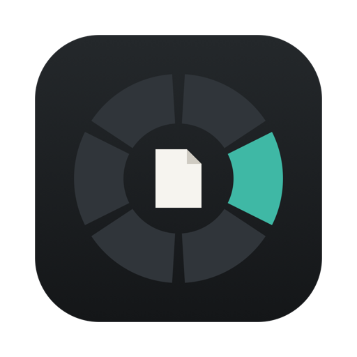
</p>

<h1 align="center">Transflo</h1>

<p align="center">
  <strong>Your files, transformed. On Mac, iPhone, iPhone Duo and iPad.</strong><br>
  Convert, edit and share images, video, audio, PDFs and documents without opening another app.<br>
  On the Mac it's a wheel at your cursor. On iPhone and iPad it's a tap away. Your files stay on your device.
</p>

<p align="center">
  <a href="https://transfloformac.ali-fayed.com"></a>
</p>

<p align="center">
  <a href="https://apps.apple.com/us/app/transflo-file-converter/id6824513929"></a>
</p>

<p align="center">
  
  
  
  
  <a href="LICENSE"></a>
</p>

<p align="center">
  <a href="#one-app-every-screen">Platforms</a> ·
  <a href="#mac">Mac</a> ·
  <a href="#iphone">iPhone</a> ·
  <a href="#iphone-duo">iPhone Duo</a> ·
  <a href="#ipad">iPad</a> ·
  <a href="#what-it-can-do">Features</a> ·
  <a href="#private-by-design">Privacy</a> ·
  <a href="#install">Install</a> ·
  <a href="#how-its-built">How it's built</a>
</p>

<p align="center">
  <a href="https://github.com/Ali-Fayed/transflo/raw/main/docs/media/transflo-platforms.mp4">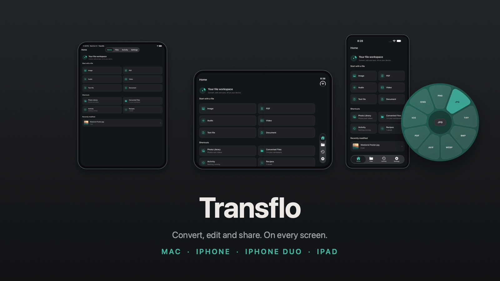</a><br>
  <sub><a href="https://github.com/Ali-Fayed/transflo/raw/main/docs/media/transflo-platforms.mp4">Watch the film</a>: Mac, iPhone, iPhone Duo folding open and iPad with Apple Pencil, in 45 seconds (19 MB, original music).</sub>
</p>

## One app, every screen

| | How you start | Made for |
|---|---|---|
| **Mac** | Drag a file in Finder, tap a key, drop it on the wheel at your cursor | Fast batch work with three wheels, Recipes and watch folders |
| **iPhone** | Pick from Photos or Files, or share from any app | Quick conversions, edits and compression on the go |
| **iPhone Duo** | The same app, folded or unfolded | A compact flow outside and a roomier editor inside, with your work where you left it |
| **iPad** | Tap, drag in from Split View, or share | Apple Pencil markup, PDF pages on a big canvas |

The same conversion catalog, editors, Recipes, compression defaults and Siri actions run on every
platform, shaped for a cursor or a finger. English and Arabic with full right-to-left layout, light and
dark, everywhere.

## Mac

<p align="center">
  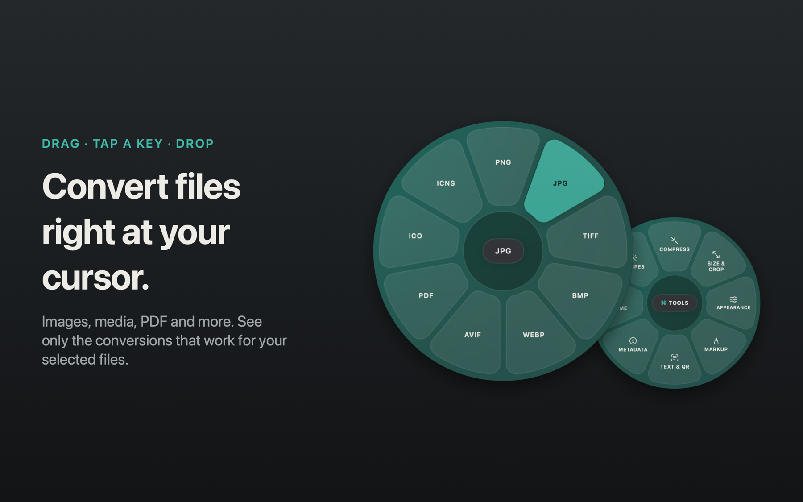
</p>

1. **Start dragging** any file (or a few) in Finder.
2. **Tap a key** while you drag. A wheel opens right under your pointer:
   - **⇧ Shift:** Convert
   - **⌘ Command:** Tools
   - **⌃ Control:** Actions
3. **Drop on a petal.** Conversions and edits create a new result beside the original. The wheel folds
   into a small disc that fills as the job runs, then ticks when it's done (or shakes with the reason if
   it fails). Click it to reveal the file. Rename and Move apply the requested change to the selected files.

The wheel stays open after you let go of the key, so take your time. Tap another key to switch wheels.
Only options that work for **every** file you're dragging are shown.

> Prefer the keyboard? Select files in Finder and press **⌥⌘Return**. Use the arrows to pick, **Return**
> to apply and **Esc** to cancel. Or right-click and choose **Quick Actions › Open in Transflo**.

<p align="center">
  
</p>

## iPhone

<p align="center">
  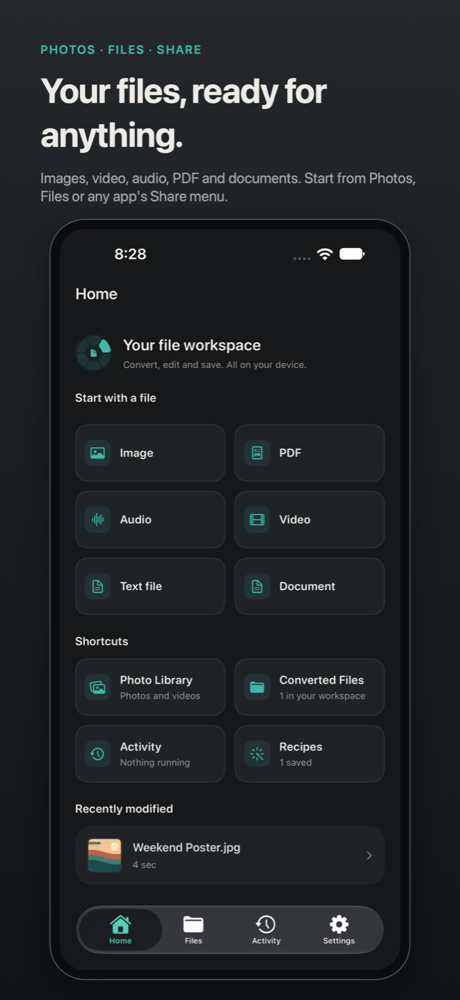
  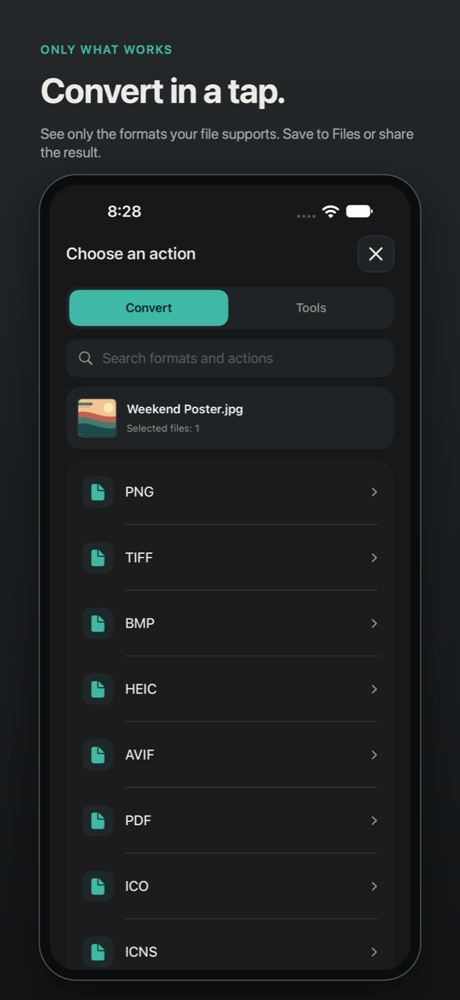
  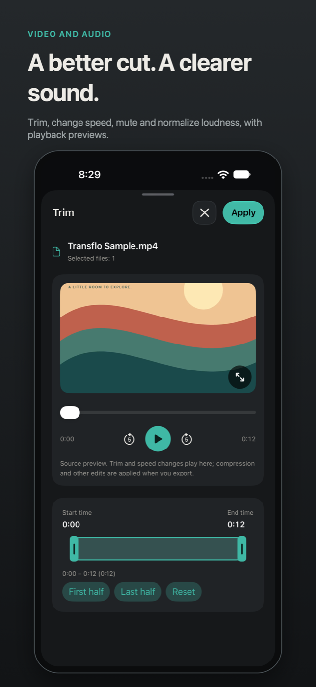
  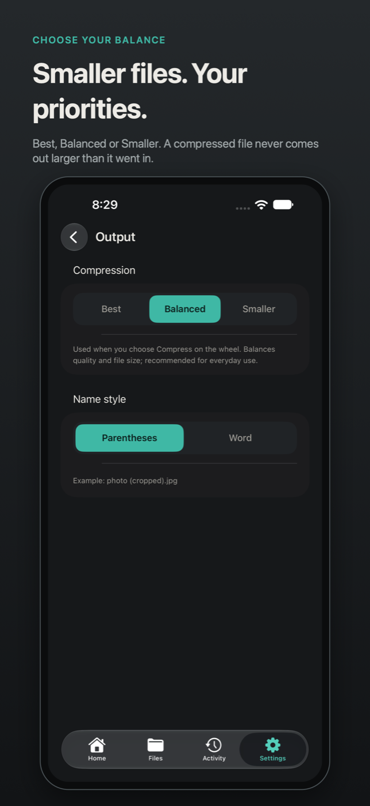
</p>

- **Start anywhere:** Home offers Image, PDF, Audio, Video, Text and Document. Pick from Photos or Files,
  open a file in Transflo, or choose **Convert with Transflo** in any app's share sheet.
- **Only what works:** a searchable Convert and Tools list shows just the formats and tools your file supports.
- **Edit with a preview:** crop, resize, adjust, remove or add a background, trim, change speed, mute, and
  reorder, split or merge PDF pages, with live previews and playback.
- **Save your way:** images go to Photos or Files; everything else opens the share sheet. Results stay in
  **Converted Files**, which you can also browse in the Files app.
- **Follow every job:** Activity shows live progress rings, lets you cancel, and keeps earlier results with
  thumbnails. Swipe to delete.
- **Never larger:** Best, Balanced or Smaller. A compressed file never comes out bigger than it went in.

## iPhone Duo

<p align="center">
  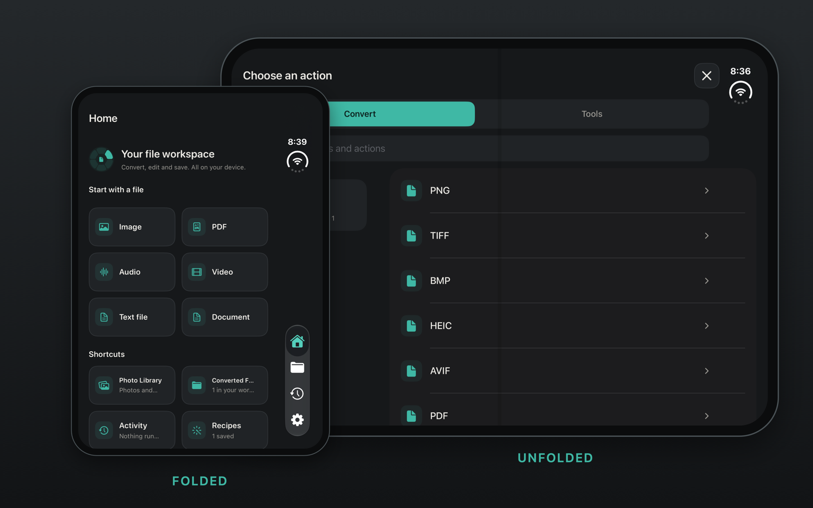
</p>

<p align="center">
  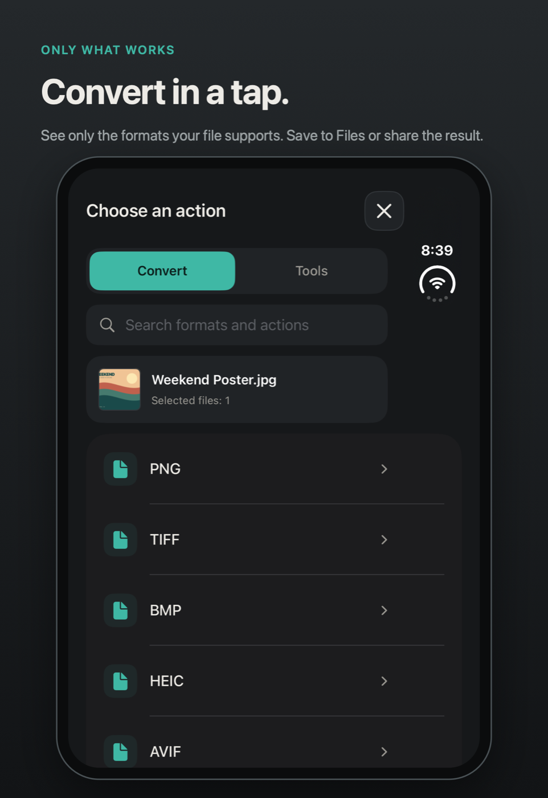
  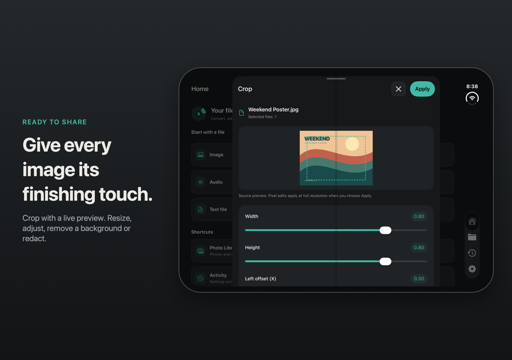
</p>

Folded, Transflo is a phone app: compact lists and one-handed editing. Unfold and the same screen gets
twice the room: lists and editors spread out, and the job you started keeps going.

## iPad

<p align="center">
  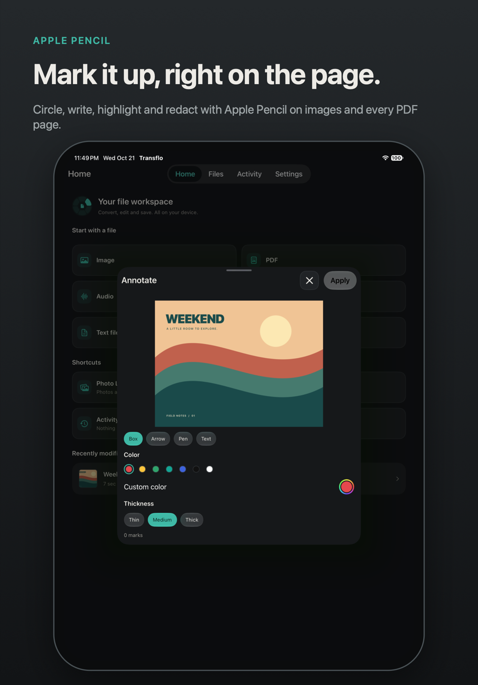
  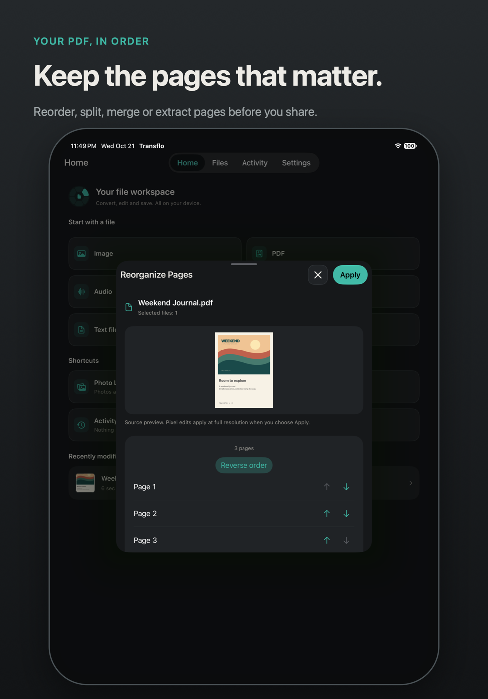
  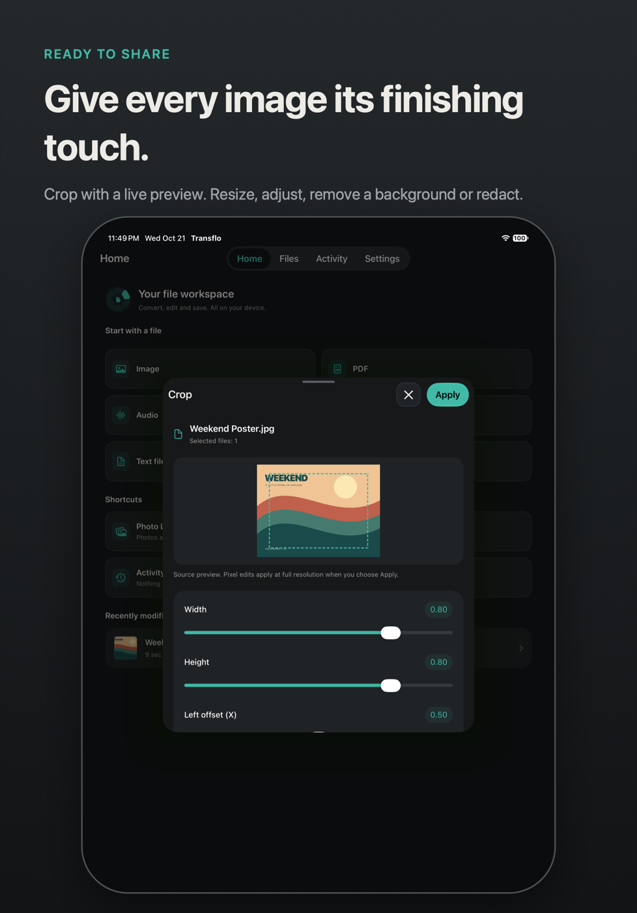
</p>

Mark up images and every PDF page with Apple Pencil: boxes, arrows, pen, text and redaction. Reorder
pages on a big canvas, drag files in from Split View, and work in portrait or landscape.

## Siri and Shortcuts, everywhere

Say "Convert this to PNG with Transflo" or "Compress this with Transflo". **Convert Files**, **Compress
Files** and **Run Recipe** are actions in the Shortcuts app on Mac, iPhone and iPad, and use your saved
output defaults.

## What it can do

The Mac runs the full catalog with the bundled FFmpeg and iWork. iPhone and iPad run Apple's native
engines, so they cover the image, video, audio, PDF and text formats those engines support. See the
[platform comparison](docs/MOBILE_PARITY.md) for details.

### Convert: 290 conversions on Mac
| Family | Formats |
|---|---|
| Images | JPG · PNG · HEIC · WebP · AVIF · TIFF · BMP · GIF · SVG (in) → PDF |
| Icons | Any image → ICO (Windows) · ICNS (macOS), and back to PNG / JPG |
| Audio | MP3 · M4A · WAV · FLAC · OGG · Opus · AIFF · WMA |
| Video | MP4 · MOV · MKV · WebM · AVI · WMV · animated GIF, plus audio extraction to MP3 |
| Documents | PDF ↔ DOCX · Pages · Markdown · TXT · EPUB · HTML · RTF / RTFD · text clippings |
| PDF | → DOCX · Pages · PPTX · XLSX · EPUB · Markdown · TXT · JPG / PNG (every page) |
| Spreadsheets | XLSX · ODS · CSV · TSV (XLS in) → PDF |
| Slides | PPTX / PPT → PDF · JPG · PNG |
| Subtitles | SRT ↔ VTT → TXT |
| Archives | ZIP · TAR · GZIP (RAR in) |

### Tools: 31 on Mac

On the Mac, the Tools wheel groups related tools under Size & Crop, Appearance, Markup, Text & QR,
Metadata, Rename, Arrange, Timeline and Audio. On iPhone and iPad the same groups appear as sections
of the searchable Tools list.

<p align="center">
  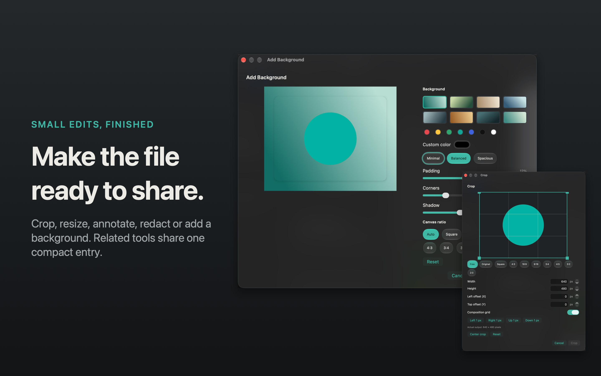
</p>

| | |
|---|---|
| **Images** | Compress · Resize · Crop · Rotate & flip · Adjust (light, color and detail) · Annotate (boxes, arrows, pen, text) · Redact · Remove background · Add background · Read QR / barcode · Images → PDF · Collage |
| **Video & audio** | Compress · Resize · Crop · Trim · Change speed · Split · Merge · Snapshot a frame · Mute · Normalize loudness · Bleep · Stereo → mono |
| **PDF** | Compress · Rotate · Split · Merge · Reorganize pages · Extract pages · Annotate · Redact (the covered text is really gone) · Read QR |
| **On-device intelligence** | Extract text (OCR, also from scanned PDFs) · Upscale 2× · Describe image (alt text) and Smart Rename with Apple Intelligence. Nothing leaves your device |
| **Archives** (Mac) | Extract ZIP, RAR, TAR and GZIP into a new folder beside the original; existing files stay untouched |
| **Metadata & names** | Edit metadata (title, author, comment) · Remove metadata (images, audio, video, PDF) · Rename any files with a pattern (`{name}`, `{n}`) |

Editors open right where you are: Crop offers aspect ratios, exact pixel dimensions and centering; Add
Background offers canvas ratios, colors, gradients, padding, corners and shadows; Adjust offers exposure,
contrast, highlights, shadows, warmth, saturation, sharpness and more, with original comparison. The
[tool editor inventory](docs/features/tool-editor-options.md) lists every editor's controls.

Compression offers Best, Balanced or Smaller for every file type. Transflo never keeps a result larger
than the original: if a preset can't shrink the file it tries the next, and if none can, it tells you the
file is already as small as it gets.

### Saved Recipes

Chain conversion, resize, compression, metadata removal or rename steps once, then run them again on
any compatible file: from Tools on the Mac, from the Tools list on iPhone and iPad, or with Siri and
Shortcuts. On the Mac, watch folders run a recipe on arriving files automatically.

<p align="center">
  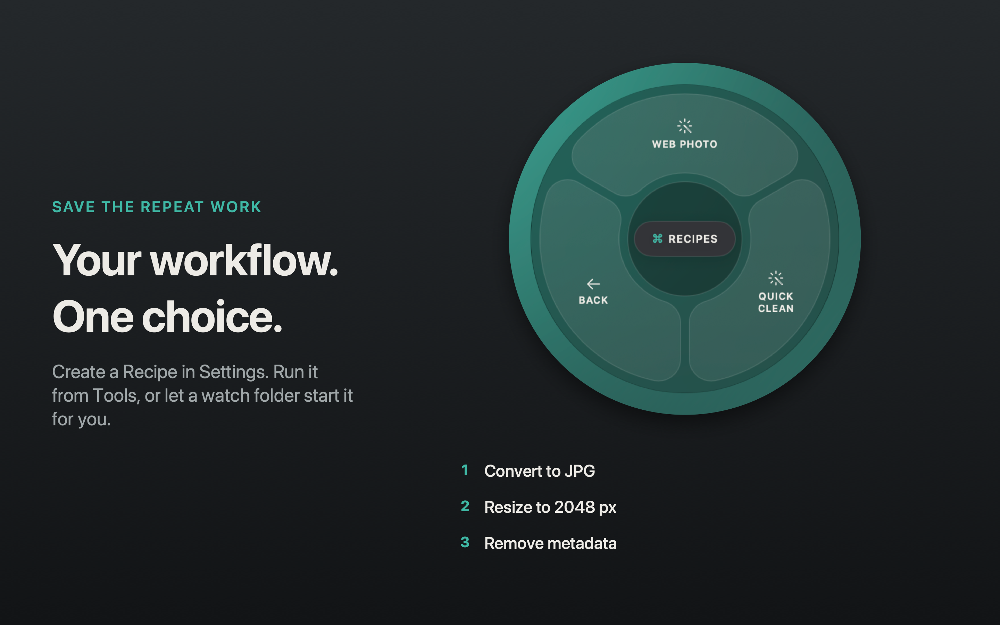
</p>

### Actions on the Mac
<p align="center">
  
</p>

**AirDrop** · **Archive**: pack selected files and folders into one ZIP · **Copy** · **Move** to a recent
folder or a new one · **Copy Path** (hold ⌥ for `~/…`) · **Terminal**: open the folder in Terminal,
iTerm, Ghostty or Warp. On iPhone and iPad, the share sheet and the Files app cover these.

## Make it yours
<p align="center">
  
</p>

- **On every platform:** accent color, light or dark, English or العربية, reduced motion, haptics, and
  which conversions and tools you see.
- **On the Mac:** Liquid Glass on macOS 26 (frosted on 14–15, or solid), wheel size, which key opens which
  wheel, your own global shortcut, tick sounds and trackpad haptics, and a History window (⌘J).
- **Output defaults:** Best, Balanced or Smaller, and how new files are named, saved per device.
- **Accessible:** VoiceOver labels and hints everywhere, finished jobs announced, Reduce Motion respected.

Browse the [current Mac captures](docs/screenshots) for individual screens in English, Arabic, light and dark.

## Private by design
Transflo does not upload files for processing. There are no accounts and no analytics. Conversions run on
your device with Apple's frameworks; on the Mac, a bundled LGPL-licensed FFmpeg covers the rest.

- **Mac:** the only network request is the update check, once a day (unless you turn it off in Settings ›
  About) and whenever you choose **Check for Updates…**. macOS may ask for Automation › Finder (keyboard
  shortcut), Automation › Pages / Keynote / Numbers (iWork conversions only), Notifications, and folder
  access in protected locations.
- **iPhone and iPad:** no network requests. Photos access is add-only and asked for only when you choose
  Save to Photos; picking a photo uses the system picker, which shares only what you select. Imports and
  results live in the app's own folder, visible in Files.

## Install
<a href="https://apps.apple.com/us/app/transflo-file-converter/id6824513929"></a>

**Transflo: File Converter** is free on the App Store: one download for **Mac**, **iPhone**,
**iPhone Duo** and **iPad**. It needs macOS 14 or later on Apple silicon, or iOS and iPadOS 17 or later.
Everything else, including the privacy policy and support, is on
**[transfloformac.ali-fayed.com](https://transfloformac.ali-fayed.com)**.

### Mac, direct download

Prefer to install outside the App Store? Use Homebrew:

```bash
brew install --cask ali-fayed/transflo/transflo
```

Or download `Transflo-1.0.0-arm64.dmg` from [Releases](https://github.com/Ali-Fayed/transflo/releases/latest),
open it and drag Transflo to Applications. Releases are signed with Developer ID and notarized by Apple.

### Build it yourself

The iPhone and iPad app, with the **Convert with Transflo** share extension, builds from the
`TransfloMobile` scheme (see [docs/DEVELOPING.md](docs/DEVELOPING.md#iphone-and-ipad)).

## FAQ
**Does it replace my files?** No. Conversions and edits create new files, such as `photo.png`,
`photo (compressed).jpg` or `photo 2.png`. Rename on the Mac changes the selected filenames; on iPhone
and iPad it makes a renamed copy and keeps the original.

**Where did the Mac icon go?** Transflo lives in the menu bar. The first launch opens Getting Started;
after that, click the menu bar icon for History, Settings, Getting Started and Check for Updates.

**Can I convert many files at once?** Yes. Only options that work for all of them are shown, and the job
processes them one by one with a single progress indicator.

**Does the iPhone app need the Mac?** No. Each app works on its own, on the device in your hand.

**Is it really free?** Yes: MIT-licensed, with no limits, trials or accounts.

## How it's built
Transflo is native Swift 6: SwiftUI for every screen on both platforms, AppKit where the Mac needs it
(floating panels, drag observation, menu bar), and three local Swift packages that keep the logic
independent of the UI. The iPhone and iPad app compiles the Mac's shared folders (design system,
localization, wheel resolution, jobs and markup editors) instead of copying them.

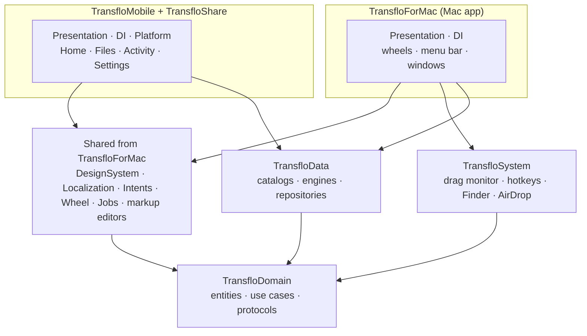

| Folder | Responsibility |
|---|---|
| `Packages/TransfloDomain` | Pure Swift: formats, wheel options, jobs, typed errors, use cases and the protocols everything implements. |
| `Packages/TransfloData` | The JSON catalogs, the engines (ImageIO, AVFoundation, PDFKit, Vision, FFmpeg, iWork) and repositories. |
| `Packages/TransfloSystem` | macOS integration: drag pasteboard, hotkeys, Finder selection, AirDrop, login items, notifications. |
| `TransfloForMac` | The Mac app, plus the design system, localization, intents, wheel and job code that mobile shares. |
| `TransfloMobile` | The iPhone and iPad app: touch components, iOS adapters (Photos, audio session), `MobileContainer`. |
| `TransfloShare` | The Share extension, built from the mobile sources. |

**Named patterns.** Strategy (engines, job presenters), Registry (`ConversionCatalog`), Decorator (wheel
visibility, App Store folder access, `ImportCommittingScheduler`), Unit of Work (`MobileProvisionalImport`),
Adapter (system and iOS integrations), Repository (settings, history), Factory (containers, editions),
Coordinator (wheel, editors, navigation). Every dependency is passed through an initializer, so every
unit is tested with hand-written doubles.

**Engines.** Apple frameworks first. On the Mac, a bundled LGPL-only FFmpeg, built reproducibly from
pinned, checksummed sources, covers what they can't write. It runs as a separate signed helper process
with argument arrays, never a shell. Cancellation reaches every engine, archives are checked against
expansion budgets, and documents are parsed with external entities disabled.

**Quality and delivery.**
- **Tests:** package tests, Mac and mobile unit tests, and native UI tests on Mac, iPhone, iPhone Duo and iPad.
- **Checks:** SwiftLint strict (zero warnings) on every target, and a secrets scan in CI.
- **Project:** generated with XcodeGen, using Xcode synchronized folders.
- **Release:** a tag starts one pipeline that ships the GitHub DMG and the Mac App Store build; Homebrew
  follows the DMG.

More detail: [architecture and folder map](docs/ARCHITECTURE.md) · [development](docs/DEVELOPING.md) ·
[platform comparison](docs/MOBILE_PARITY.md) · [releasing](docs/RELEASING.md).

## Build from source
See [docs/DEVELOPING.md](docs/DEVELOPING.md) to build and test the Mac and mobile apps and to render the
marketing assets, and [docs/RELEASING.md](docs/RELEASING.md) to cut a release.

Changes are welcome: start with [CONTRIBUTING.md](CONTRIBUTING.md). For private vulnerability reports, see
[SECURITY.md](SECURITY.md).

## License
Transflo is released under the [MIT License](LICENSE). The Mac app bundles FFmpeg (LGPL 2.1+) and a few
codec libraries; see [THIRD_PARTY_NOTICES.md](THIRD_PARTY_NOTICES.md) for licenses, sources and the written
offer.

Transflo is an independent project and isn't affiliated with Apple.
